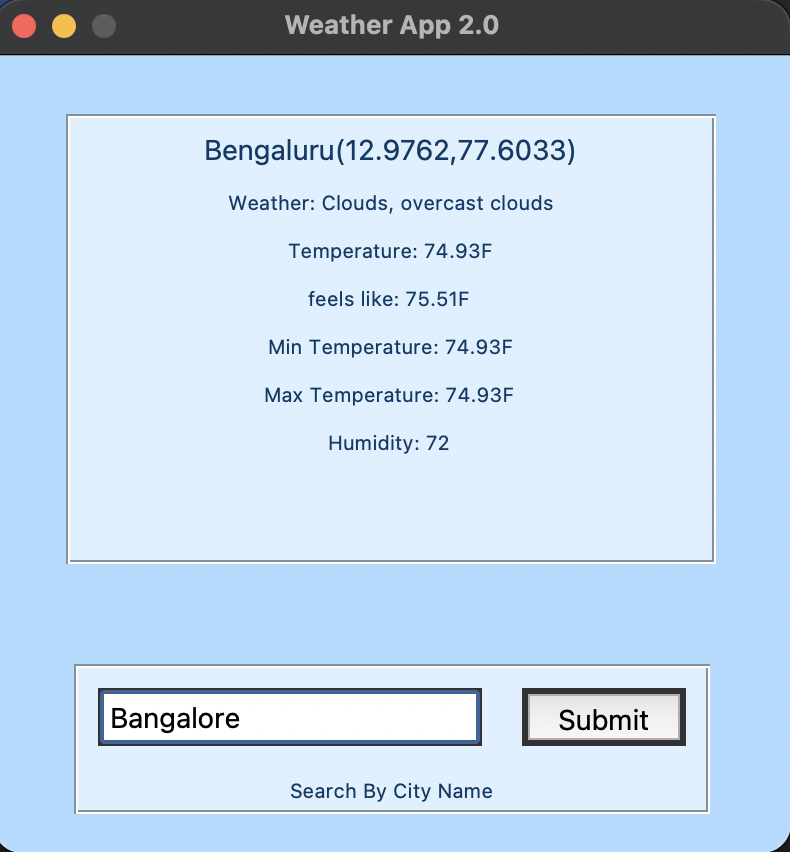

# Weather App 2.0

A small desktop weather application built with Python and Tkinter. It lets users look up current weather by city name or ZIP/postal code using the OpenWeatherMap Current Weather API.

## Screenshots



## Features

- Desktop interface built with Tkinter
- Search by city name
- Displays the location name and coordinates
- Displays weather conditions, description, temperature, “feels like” temperature, minimum and maximum temperature, and humidity
- Uses Fahrenheit (`units=imperial`)
- Uses a simple blue-themed interface

## Built with

- Python
- Tkinter (`tkinter`)
- Requests (`requests`) for API calls
- OpenWeatherMap Current Weather API

## Requirements

- Python 3.9 or later recommended
- An OpenWeatherMap API key
- Python packages:
  - `requests`


Install the dependencies:

```bash
python -m pip install requests Pillow matplotlib
```

## Setup and run

1. Download or clone this project.
2. Configure your OpenWeatherMap API key.
3. Run:

```bash
python "Weather App 2.0.py"
```

## How to use

1. Launch the application.
2. Choose **Search By City Name** 
3. Enter a city name or postal code.
4. Click **Submit**.
5. Read the current weather details in the results panel.

## Suggested improvements

1. Read the API key from an environment variable rather than storing it in source code.
2. Display weather icons.
3. Add validation and friendly error messages for empty searches, invalid locations, HTTP errors, and connection timeouts.
4. Add a loading state so the interface remains clear while a request is in progress.
5. Consider allowing users to switch between Fahrenheit and Celsius.

## Project purpose

This project was built to explore Python desktop GUI development, API integration, JSON response handling, and presenting live data in an application interface.
